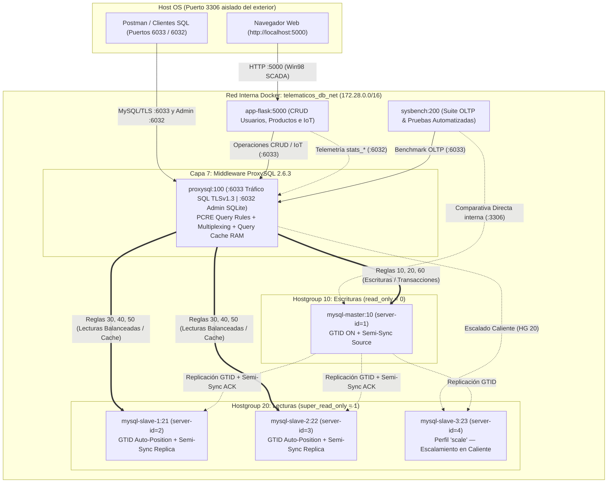

# Clúster de Bases de Datos MySQL 8.0 con Balanceo de Carga L7 y ProxySQL 2.x


-blue?logo=mysql)
-orange?logo=mysql)
-green?logo=flask)


> **Universidad Autónoma de Occidente (UAO) — Cali, Colombia**  
> **Facultad de Ingeniería — Departamento de Operaciones y Sistemas**  
> **Asignatura:** Servicios Telemáticos (Período 2026-02)  
> **Docente Evaluador:** Prof. Oscar Mondragón  
> **Proyecto Final:** Proyecto 4 — Balanceo de cargas de bases de datos MySQL con ProxySQL (Lista 2)  
> **Integrantes:**  
> - **Eduard Criollo Yule** (`eduard.criollo@uao.edu.co`)  
> - **Felipe Charria Caicedo** (`felipe.charria@uao.edu.co`)  

---

## 1. Descripción General del Proyecto

Este repositorio implementa un clúster reproducible y contenerizado de bases de datos **MySQL 8.0** de alta disponibilidad orquestado mediante **ProxySQL 2.6.3** como balanceador inteligente en **Capa 7 (SQL-Aware)** bajo arquitectura determinista (*Zero-Flake Engineering*).

### Capacidades Principales Implementadas
* **Enrutamiento Transparente en Capa 7 (Read/Write Split):** Los clientes y aplicaciones conectan a un único endpoint (`:6033`). Mediante 6 reglas regex PCRE compiladas en `mysql_query_rules`, ProxySQL dirige escrituras y bloqueos (`INSERT`, `UPDATE`, `DELETE`, `SELECT ... FOR UPDATE`) al Maestro (Hostgroup 10) y distribuye lecturas `SELECT` entre las réplicas (Hostgroup 20).
* **Consistencia Transaccional ACID:** `transaction_persistent = 1` ancla todas las operaciones dentro de una transacción abierta (`START TRANSACTION ... COMMIT`) al Hostgroup 10, eliminando lecturas sucias.
* **Aplicación Web Transaccional (Práctica 9 Integrada):** Microservicio Flask (`app-flask`) + interfaz **Windows 98 / SCADA Retro (`PROXYSQL_L7.EXE`)** con CRUD completo de **Productos (`/api/products`)**, **Usuarios (`/api/users`)** y **Telemetría IoT (`/api/telemetry`)**, reportando en cada respuesta el nodo resolvedor (`@@hostname`), `server_id`, hostgroup y latencia.
* **Replicación GTID + Semi-Sync:** Topología `mysql-master` + `mysql-slave-1` + `mysql-slave-2` con `SOURCE_AUTO_POSITION = 1` y plugin semi-síncrono (`rpl_semi_sync`) para reducir la pérdida de datos (RPO ≈ 0) ante fallos del primario.
* **Connection Pooling y Multiplexing M:N:** Pool persistente de sockets backend que absorbe ráfagas concurrentes (`120` clientes simultáneos sobre `21` sockets físicos con `ConnERR = 0`).
* **Query Cache Sub-ms en RAM (Regla 30):** Cacheo en memoria para consultas etiquetadas con `/*+ CACHE */` (TTL `5,000 ms`, `mysql-query_cache_handle_warnings = 1`), reduciendo lecturas analíticas de `26.703 ms` a `1.103 ms` (`24.2x` en vivo).
* **Escalamiento Horizontal en Caliente:** Perfil opcional `--profile scale` (`mysql-slave-3`) integrable dinámicamente en Runtime sin reiniciar ProxySQL ni cerrar sesiones activas.
* **Cifrado en Tránsito TLSv1.3 (X.509):** Comunicación obligatoria `--ssl-mode=REQUIRED` validada sobre `:6033` con suite criptográfica `TLS_AES_256_GCM_SHA384`.
* **Matriz Paramétrica & Colección Postman:** Benchmarks Sysbench comparativos (`Directo` vs `ProxySQL`), variación de concurrencia (`4`, `16`, `64` hilos), variación de pesos (`1000:1000` vs `3000:1000` vs 3 réplicas) e informe técnico oficial en formato IEEE ([`docs/Informe_IEEE_Proyecto4_ProxySQL.pdf`](docs/Informe_IEEE_Proyecto4_ProxySQL.pdf)).

---

## 2. Diagrama de Arquitectura Telemática



---

## 3. Estructura Completa del Repositorio

```text
ProyectoFinal/
├── .env.example                           # Plantilla parametrizada de variables de entorno y credenciales
├── .gitattributes                         # Normalización EOL LF para scripts en Linux/Windows
├── .gitignore                             # Exclusiones de entorno local (.env, .venv), binarios y archivos no versionados
├── Makefile                               # Atajos de despliegue, sincronización runtime y ejecución de pruebas
├── README.md                              # Documentación técnica completa del proyecto
├── docker-compose.yml                     # Orquestación completa (MySQL 8.0, ProxySQL 2.6.3, Flask, Sysbench)
├── app-flask/                             # Aplicación Web y API REST (Práctica 9 Integrada)
│   ├── Dockerfile                         # Contenedor Python 3.11-slim
│   ├── app.py                             # API RESTful (/api/users, /api/products, /api/telemetry, /api/cluster/*)
│   ├── requirements.txt                   # Dependencias Python (Flask, PyMySQL[rsa], cryptography, gunicorn)
│   └── templates/
│       └── index.html                     # Monitor Web Windows 98 / SCADA Retro (`PROXYSQL_L7.EXE`)
├── docs/                                  # Documentación Académica Oficial
│   └── Informe_IEEE_Proyecto4_ProxySQL.pdf # Informe técnico final en formato IEEE (doble columna)
├── mysql/                                 # Configuración, inicialización y healthchecks MySQL 8.0
│   ├── conf/
│   │   ├── master.cnf                     # Parámetros GTID ON, ROW binlog y read_only=0
│   │   ├── slave1.cnf                     # Parámetros GTID ON y super_read_only=1
│   │   ├── slave2.cnf
│   │   └── slave3.cnf
│   ├── init-master/
│   │   └── 01-init-master.sql             # Esquema UTF-8 (users, products, iot_telemetry) y privilegios
│   └── scripts/
│       ├── master-healthcheck.sh          # Healthcheck real contra falsos positivos de arranque
│       ├── slave-entrypoint.sh            # Registro GTID idempotente con SOURCE_AUTO_POSITION=1
│       └── slave-healthcheck.sh           # Validación continua Replica_IO_Running & Replica_SQL_Running
├── postman/                               # Colección de Pruebas API REST
│   └── Proyecto4_Postman_Collection.json  # Endpoints CRUD y validación de enrutamiento HTTP/SQL
├── presentacion/                          # Material Visual de Sustentación
│   └── Presentacion_Proyecto4_ProxySQL.pdf # Diapositivas oficiales del proyecto (11 láminas)
├── proxysql/                              # Configuración Middleware Capa 7
│   ├── proxysql.cnf                       # Hostgroups 10/20, 6 reglas PCRE, Query Cache, monitor y TLS
│   └── sync-runtime.sh                    # Persistencia SQLite (LOAD TO RUNTIME / SAVE TO DISK)
├── results/                               # Evidencias Experimentales Empíricas
│   ├── benchmark_metrics.csv              # Comparativa Sysbench OLTP Directo vs ProxySQL (16 hilos)
│   ├── live_metrics.json                  # Métricas reales consolidadas de ejecución E2E
│   ├── scenarios_load_variation.csv       # Escenarios de carga (4, 16 y 64 hilos)
│   ├── scenarios_weights.csv              # Distribución Weighted Round-Robin (B1, B2 y B3)
│   ├── sysbench_4t.log                    # Log Sysbench OLTP 4 hilos
│   ├── sysbench_16t.log                   # Log Sysbench OLTP 16 hilos
│   ├── sysbench_64t.log                   # Log Sysbench OLTP 64 hilos
│   ├── sysbench_Cluster_ProxySQL_oltp_read_only.log
│   ├── sysbench_Cluster_ProxySQL_oltp_read_write.log
│   ├── sysbench_Directo_Master_oltp_read_only.log
│   └── sysbench_Directo_Master_oltp_read_write.log
├── scripts/                               # Suite Automatizada de Validación (Pruebas 1 a 9)
│   ├── demo_weights_bench.sh              # Script auxiliar para medición determinista de pesos HG 20
│   ├── run_all_demos.sh                   # Orquestador secuencial de pruebas funcionales y rendimiento
│   ├── test1_query_routing.sh             # Prueba 1: Segregación L7 R/W y @@hostname
│   ├── test2_master_failover.sh           # Prueba 2: Caída del Maestro, lectura continua y promoción GTID
│   ├── test3_sysbench_benchmark.sh        # Prueba 3: Comparativa Sysbench OLTP (Directo vs ProxySQL)
│   ├── test4_connection_pooling.sh        # Prueba 4: Ráfaga 120 clientes concurrentes (Multiplexing)
│   ├── test5_hot_scale_slave3.sh          # Prueba 5: Incorporación en caliente de mysql-slave-3
│   ├── test6_query_cache.sh               # Prueba 6: Aceleración Query Cache en RAM (/*+ CACHE */)
│   ├── test7_flask_e2e.sh                 # Prueba 7: Pruebas E2E CRUD de Usuarios y Productos
│   ├── test8_tls_security.sh              # Prueba 8: Auditoría de cifrado TLSv1.3 X.509
│   └── test9_parametric_scenarios.sh      # Prueba 9: Variación paramétrica de carga y pesos
└── sysbench/
    └── Dockerfile                         # Imagen cliente Sysbench + utilidades MySQL
```

---

## 4. Instrucciones de Despliegue y Reproducción

### 4.1. Requisitos del Sistema
* **Docker Desktop 20.10+** con soporte **Docker Compose v2**.
* Puertos disponibles en el host: `5000` (Dashboard Web), `6033` (ProxySQL Datos) y `6032` (ProxySQL Admin).
* **Aislamiento de puertos:** El puerto `3306` **no se expone al host**, evitando colisiones con motores MySQL/MariaDB locales.

### 4.2. Arranque Determinista (*Zero-Flake*)

```bash
# 1. Acceder a la raíz del proyecto
cd ProyectoFinal

# 2. Crear archivo de variables de entorno local a partir de la plantilla
cp .env.example .env
# (En Windows PowerShell: Copy-Item .env.example .env)

# 3. Construir e iniciar todos los contenedores en segundo plano
docker compose up -d --build

# 4. Verificar que todos los nodos alcancen estado healthy
docker compose ps
```

### 4.3. Endpoints y Puntos de Conexión
* **Dashboard Web (`PROXYSQL_L7.EXE`):** `http://localhost:5000`
  - **Pestaña 1 (`Clúster & ProxySQL L7`):** Estado vivo de Hostgroup 10/20, pool de sockets, ráfagas transaccionales y monitor CRT de eventos.
  - **Pestaña 2 (`Productos (Práctica 9)`):** CRUD completo conectado por ProxySQL `:6033` (escrituras a `mysql-master`, lecturas a réplicas).
  - **Pestaña 3 (`Usuarios (Práctica 9)`):** CRUD de usuarios con trazabilidad L7 por fila.
  - **Pestaña 4 (`Escenarios de Carga & Pesos`):** Disparo interactivo de carga concurrente (4, 16, 64 hilos) y comparativa de pesos.
* **Punto Único SQL (ProxySQL L7):** `127.0.0.1:6033` (`user=cluster_app`, `db=telematicos_db`)
* **Consola Administrativa SQLite (ProxySQL Admin):** `127.0.0.1:6032` (`user=radmin`, `password=radmin`)

### 4.4. Query Routing Implementado (`mysql_query_rules`) y Verificación en `:6032`

ProxySQL evalúa secuencialmente en Capa 7 las 6 reglas PCRE compiladas desde [`proxysql/proxysql.cnf`](proxysql/proxysql.cnf) (`transaction_persistent = 1` en `cluster_app` mantiene transacciones `START TRANSACTION ... COMMIT` ancladas en HG 10):

| `rule_id` | Expresión Regular (`match_pattern`) | Destino (`HG`) |TTL / Acción | Propósito Telemático |
| :---: | :--- | :---: | :---: | :--- |
| `10` | `^SELECT.*FOR UPDATE$` | `HG 10` | `apply=1` | Lecturas con bloqueo pesimista al Maestro (coherencia ACID) |
| `20` | `^SELECT.*(LAST_INSERT_ID\|FOUND_ROWS\|ROW_COUNT\|GET_LOCK)` | `HG 10` | `apply=1` | Funciones dependientes de estado de sesión en Maestro |
| `30` | `^SELECT.*\/\*\+\s*CACHE\s*\*\/` | `HG 20` | `cache_ttl=5000` | Respuesta directa desde Query Cache en RAM (5 s TTL) |
| `40` | `^SELECT.*@@(hostname\|server_id\|read_only\|gtid_executed)` | `HG 20` | `apply=1` | Inspección y telemetría distribuida hacia réplicas |
| `50` | `^SELECT` | `HG 20` | `apply=1` | Balanceo general de lecturas (*Weighted Round-Robin*) |
| `60` | `^(INSERT\|UPDATE\|DELETE\|REPLACE\|CREATE\|ALTER\|DROP\|TRUNCATE)` | `HG 10` | `apply=1` | Operaciones de escritura y DDL estrictamente al Maestro |

Para auditar en vivo el balanceo, los hits de cada regla y la multiplexación del pool desde cualquier terminal o cliente MySQL:

```bash
# Inspeccionar hostgroups activos, reglas compiladas, conteo por regla, digest SQL y pool M:N
mysql -h 127.0.0.1 -P 6032 -u radmin -pradmin -t -e "
  SELECT hostgroup_id, hostname, status, weight FROM runtime_mysql_servers ORDER BY hostgroup_id, hostname;
  SELECT rule_id, match_pattern, destination_hostgroup, cache_ttl, apply FROM runtime_mysql_query_rules ORDER BY rule_id;
  SELECT rule_id, hits FROM stats_mysql_query_rules ORDER BY rule_id;
  SELECT hostgroup, substr(digest_text,1,55) AS sql_pattern, count_star, sum_time FROM stats_mysql_query_digest ORDER BY count_star DESC LIMIT 10;
  SELECT hostgroup, srv_host, status, ConnUsed, ConnFree, ConnOK, ConnERR, Queries FROM stats_mysql_connection_pool;
"
```

---

## 5. Batería de Pruebas Automatizadas

Todas las pruebas se ejecutan dentro de la red interna mediante `Makefile` o `docker compose exec`:

| Comando | Prueba | Alcance Técnico |
| :---: | :--- | :--- |
| `make test1` | **Query Routing** | Comprueba el envío de escrituras a HG 10 (`mysql-master`) y `SELECT` a HG 20 (`slave-1`/`slave-2`). |
| `make test2` | **Master Failover** | Simula detención de `mysql-master`, continuidad 100 % en lecturas HG 20 y promoción GTID. |
| `make test3` | **Benchmark Sysbench** | Ejecuta cargas `oltp_read_only` y `oltp_read_write` comparando conexión directa vs ProxySQL. |
| `make test4` | **Connection Pooling** | Lanza 120 clientes simultáneos multiplexados sobre sockets persistentes (`ConnERR = 0`). |
| `make test5` | **Hot Scale Réplica 3** | Levanta `mysql-slave-3` bajo perfil `scale` y lo inyecta en HG 20 sin reiniciar ProxySQL. |
| `make test6` | **Query Cache RAM** | Valida la Regla 30 (`/*+ CACHE */`) respondiendo directamente desde memoria RAM. |
| `make test7` | **CRUD Real E2E** | Verifica el ciclo completo `POST`/`GET`/`PUT`/`DELETE` en `/api/users` y `/api/products`. |
| `make test8` | **Seguridad TLSv1.3** | Valida `--ssl-mode=REQUIRED` y negociación criptográfica `TLS_AES_256_GCM_SHA384`. |
| `make test9` | **Escenarios Paramétricos** | Ejecuta la matriz de carga (`4`, `16`, `64` hilos) y pesos dinámicos (`50/50`, `75/25`, 3 nodos). |
| `make demo` | **Suite Secuencial** | Ejecuta todas las pruebas automatizadas en cadena. |

---

## 6. Resultados Empíricos Consolidados

Métricas reales registradas en [`results/`](results/) sobre clúster contenerizado en Docker Desktop (monohost):

### 6.1. Comparativa Sysbench OLTP 16 Hilos — Ráfagas de 15 s ([`results/benchmark_metrics.csv`](results/benchmark_metrics.csv))
> Ventana medida en los registros adjuntos: `15 s` por perfil sobre CPU compartida (`duration_sec=15`). Para corridas extendidas de `120 s`, ejecutar `SYSBENCH_TIME=120 ./scripts/test3_sysbench_benchmark.sh` dentro del contenedor `sysbench`.

| Perfil OLTP | Topología | TPS | QPS | Latencia Media | p95 |
| :--- | :--- | :---: | :---: | :---: | :---: |
| `oltp_read_only` | Directo al Maestro | `791.26` | `12,660.11` | `20.18 ms` | `54.83 ms` |
| `oltp_read_only` | Clúster ProxySQL (L7 + TLSv1.3) | `291.27` | `4,660.30` | `54.84 ms` | `106.75 ms` |
| `oltp_read_write` | Directo al Maestro | `267.87` | `5,357.44` | `59.55 ms` | `161.51 ms` |
| `oltp_read_write` | Clúster ProxySQL (L7 + TLSv1.3) | `154.42` | `3,088.34` | `101.77 ms` | `253.35 ms` |

> **Lectura ingenieril honesta:** Al ejecutarse todos los nodos compartiendo la CPU de un mismo host Docker, el análisis gramatical PCRE en Capa 7 y el cifrado TLSv1.3 introducen un *overhead* medible frente a la conexión directa al Maestro. A cambio, ProxySQL aporta separación R/W transparente, pooling sin saturación, failover automático, Query Cache en RAM y escalabilidad horizontal cuando las réplicas se despliegan en nodos físicos dedicados.

### 6.2. Variación de Concurrencia (`4 -> 16 -> 64` hilos, 15 s/perfil — [`results/scenarios_load_variation.csv`](results/scenarios_load_variation.csv))
| Escenario | Hilos | TPS | QPS | Latencia Media | p95 | Errores TCP |
| :--- | :---: | :---: | :---: | :---: | :---: | :---: |
| Carga Baja (IoT Nominal) | `4` | `109.55` | `1,752.81` | `36.44 ms` | `64.47 ms` | `0` |
| Carga Media (Estándar OLTP) | `16` | `198.31` | `3,172.96` | `80.48 ms` | `158.63 ms` | `0` |
| Carga Alta (Estrés de Pool) | `64` | `248.86` | `3,981.73` | `255.04 ms` | `511.33 ms` | `0` |

### 6.3. Pesos Weighted Round-Robin, Resiliencia, Caché RAM y TLS ([`results/scenarios_weights.csv`](results/scenarios_weights.csv) y [`results/live_metrics.json`](results/live_metrics.json))
* **Reparto por pesos (HG 20):**
  - Simétrico `1000 : 1000` -> `52.0 %` / `48.0 %` (batch CSV) | `44.5 %` / `55.5 %` (muestra E2E de 200 consultas).
  - Asimétrico `3000 : 1000` -> `77.0 %` / `23.0 %` (batch CSV) | `76.5 %` / `23.5 %` (muestra E2E de 200 consultas).
  - Escalado caliente 3 réplicas (`1000 : 1000 : 1000`) -> `33.3 %` / `33.3 %` / `33.4 %` (batch CSV) | `35.3 %` / `36.7 %` / `28.0 %` (muestra E2E de 150 consultas).
* **Tolerancia a fallos GTID:** Detección de caída de `mysql-master` en `4.44 s`, `100 %` de lecturas continuas sobre HG 20 y promoción activa de `mysql-slave-1`.
* **Multiplexing M:N:** `120` clientes simultáneos atendidos en `21` sockets backend con `ConnERR = 0`.
* **Query Cache en RAM (100k filas `sbtest1`):** Reducción de `26.703 ms` a `1.103 ms` (**`24.2x`** más rápido, `77` aciertos `GET_OK` en `21,389 bytes`).
* **Cifrado en tránsito:** Protocolo `TLSv1.3` con suite `TLS_AES_256_GCM_SHA384`.

---

## 7. Documentación Técnica, Sustentación y Pruebas API

* **Informe Técnico IEEE (PDF):** [`docs/Informe_IEEE_Proyecto4_ProxySQL.pdf`](docs/Informe_IEEE_Proyecto4_ProxySQL.pdf)
* **Presentación de Sustentación (PDF):** [`presentacion/Presentacion_Proyecto4_ProxySQL.pdf`](presentacion/Presentacion_Proyecto4_ProxySQL.pdf)
* **Colección Postman:** [`postman/Proyecto4_Postman_Collection.json`](postman/Proyecto4_Postman_Collection.json)

---

## 8. Licencia y Créditos Académicos

Desarrollado para la asignatura **Servicios Telemáticos (2026-02)** en la **Universidad Autónoma de Occidente (UAO)**.  
Código fuente liberado bajo licencia **GNU General Public License v3.0 (GPLv3)**.
